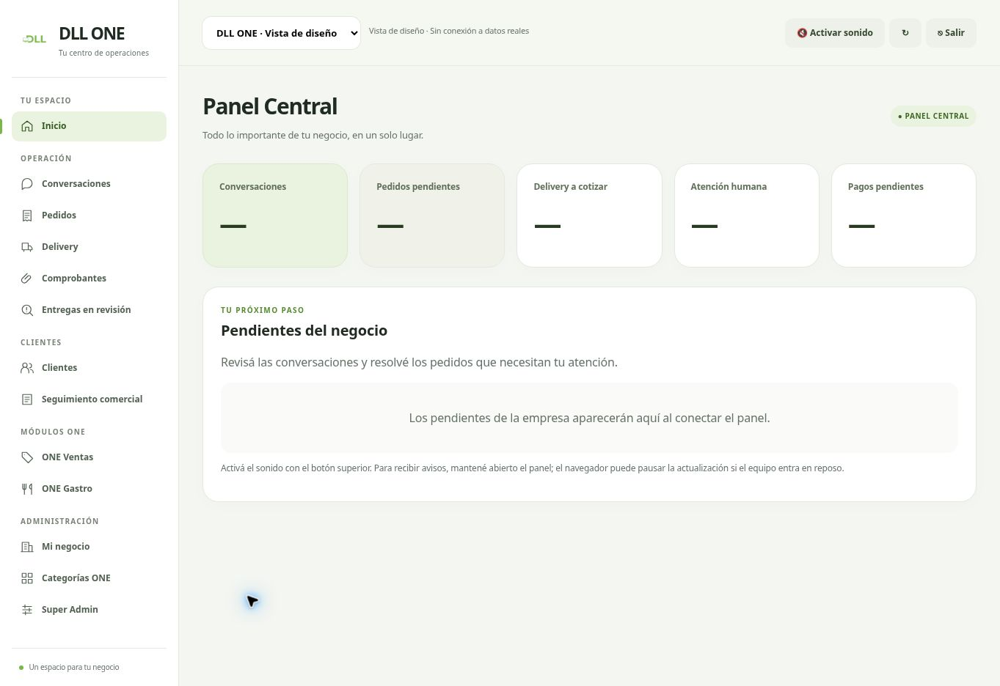

# Panel organizado por secciones

Mantiene logo y colores DLL ONE. Navegación agrupada en Inicio, Operación, Clientes, Módulos y Administración; estilo compartido para todas las pantallas. Mi negocio, Super Admin y Salud usan pestañas accesibles. Gastro agrupa menú visual, medios de pago y delivery en paneles desplegables. Seguimiento comercial también está disponible desde Más en móvil.

Los controles originales conservan sus IDs, valores, acciones y permisos. Los fieldsets de Gastro conservan su ascendencia y bloqueo. El guardado de datos generales sigue siendo una sola operación con el botón original. La fecha de Salud queda compartida entre agenda y recepción. No modifica motor, API, base de datos, credenciales ni dependencias.

Validación: 128 pruebas del panel; comprobación de sintaxis; navegador de escritorio y vista móvil de 390px. Pruebas nuevas de integridad DOM, conservación de ediciones al cambiar de pestaña, navegación por teclado, bloqueos de formularios y acceso móvil a seguimiento comercial. Tras los ajustes finales de iconografía se repitieron las 4 pruebas de interfaz.

La captura usa una vista local sin conexión ni datos de clientes. No representa una sesión autenticada de producción. Pendiente validar carga/guardado con datos reales y roles reales después de aprobar el despliegue.

